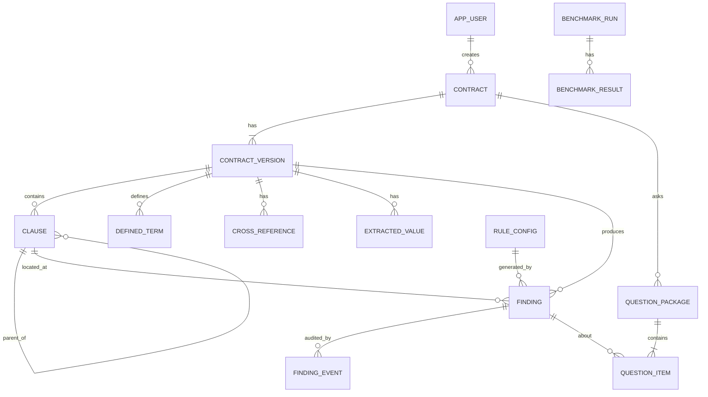

# Thiết kế cơ sở dữ liệu

## 1. Lựa chọn công nghệ

| Thành phần | Công nghệ | Dùng cho |
|---|---|---|
| Dữ liệu chính | **PostgreSQL 16** | Hợp đồng, cây điều khoản, finding, workflow, audit. Có quan hệ chặt, cần transaction và ràng buộc toàn vẹn, có `jsonb` cho phần linh hoạt |
| Cache / token | **Redis 7** | Token link luật sư (TTL), rate limit |
| Migration | **Flyway** | Schema có version, dựng lại bằng một lệnh |
| File gốc | Local disk / MinIO | DB chỉ lưu đường dẫn, không lưu file nhị phân |

**Vì sao không dùng MongoDB:** dữ liệu ở đây có quan hệ rõ (contract → version → clause → finding → question) và cần transaction khi đổi trạng thái kèm ghi audit. PostgreSQL phù hợp hơn. Phần dữ liệu linh hoạt (tham số rule, danh sách đáp án) dùng `jsonb`.

## 2. Sơ đồ quan hệ (ER)



Nhóm bảng:

| Nhóm | Bảng |
|---|---|
| Người dùng | `app_user` |
| Hợp đồng | `contract`, `contract_version` |
| Cấu trúc đã parse | `clause`, `defined_term`, `cross_reference`, `extracted_value` |
| Lỗi và workflow | `finding`, `finding_event` |
| Hỏi luật sư | `question_package`, `question_item` |
| Cấu hình | `rule_config` |
| Đánh giá | `benchmark_run`, `benchmark_result` |

## 3. Schema chi tiết (DDL)

### 3.1 `V1__init_users.sql`

```sql
CREATE TABLE app_user (
    id            BIGSERIAL PRIMARY KEY,
    email         VARCHAR(255) NOT NULL UNIQUE,
    password_hash VARCHAR(100) NOT NULL,              -- BCrypt
    full_name     VARCHAR(150) NOT NULL,
    role          VARCHAR(20)  NOT NULL CHECK (role IN ('REVIEWER', 'ADMIN')),
    active        BOOLEAN      NOT NULL DEFAULT TRUE,
    created_at    TIMESTAMPTZ  NOT NULL DEFAULT now()
);
```

### 3.2 `V2__contract_and_structure.sql`

```sql
CREATE TABLE contract (
    id          BIGSERIAL PRIMARY KEY,
    title       VARCHAR(255) NOT NULL,
    status      VARCHAR(30)  NOT NULL DEFAULT 'IN_REVIEW'
                CHECK (status IN ('IN_REVIEW', 'READY_FOR_DIGITIZATION', 'ARCHIVED')),
    created_by  BIGINT       NOT NULL REFERENCES app_user(id),
    created_at  TIMESTAMPTZ  NOT NULL DEFAULT now(),
    updated_at  TIMESTAMPTZ  NOT NULL DEFAULT now()
);

CREATE TABLE contract_version (
    id              BIGSERIAL PRIMARY KEY,
    contract_id     BIGINT       NOT NULL REFERENCES contract(id) ON DELETE CASCADE,
    version_no      INT          NOT NULL,
    file_name       VARCHAR(255) NOT NULL,
    file_type       VARCHAR(10)  NOT NULL CHECK (file_type IN ('DOCX', 'PDF')),
    storage_path    VARCHAR(500) NOT NULL,
    file_sha256     CHAR(64)     NOT NULL,
    page_count      INT,
    status          VARCHAR(20)  NOT NULL DEFAULT 'ANALYZING'
                    CHECK (status IN ('ANALYZING', 'REVIEW_READY', 'FAILED')),
    unparsed_lines  INT          NOT NULL DEFAULT 0,      -- số dòng parser không nhận ra
    failure_reason  TEXT,
    uploaded_by     BIGINT       NOT NULL REFERENCES app_user(id),
    uploaded_at     TIMESTAMPTZ  NOT NULL DEFAULT now(),
    analyzed_at     TIMESTAMPTZ,
    UNIQUE (contract_id, version_no)
);

-- Cây điều khoản (Article → Section → Clause) lưu theo adjacency list
CREATE TABLE clause (
    id            BIGSERIAL PRIMARY KEY,
    version_id    BIGINT      NOT NULL REFERENCES contract_version(id) ON DELETE CASCADE,
    parent_id     BIGINT      REFERENCES clause(id) ON DELETE CASCADE,
    level         SMALLINT    NOT NULL,                   -- 1 = Article, 2 = Section, 3 = Clause
    label         VARCHAR(30) NOT NULL,                   -- "2", "2.1", "2.1(a)"
    title         VARCHAR(255),
    body          TEXT        NOT NULL,                   -- nội dung đã chuẩn hóa
    seq           INT         NOT NULL,                   -- thứ tự xuất hiện trong văn bản
    page          INT,
    start_offset  INT         NOT NULL,                   -- vị trí trong full text của version
    end_offset    INT         NOT NULL,
    UNIQUE (version_id, seq)
);
CREATE INDEX idx_clause_version_label ON clause(version_id, label);
CREATE INDEX idx_clause_parent        ON clause(parent_id);

CREATE TABLE defined_term (
    id                   BIGSERIAL PRIMARY KEY,
    version_id           BIGINT       NOT NULL REFERENCES contract_version(id) ON DELETE CASCADE,
    term                 VARCHAR(200) NOT NULL,
    definition_clause_id BIGINT       REFERENCES clause(id) ON DELETE SET NULL,
    definition_text      TEXT         NOT NULL,
    usage_count          INT          NOT NULL DEFAULT 0
);
CREATE INDEX idx_term_version ON defined_term(version_id, term);

CREATE TABLE cross_reference (
    id               BIGSERIAL PRIMARY KEY,
    version_id       BIGINT      NOT NULL REFERENCES contract_version(id) ON DELETE CASCADE,
    source_clause_id BIGINT      NOT NULL REFERENCES clause(id) ON DELETE CASCADE,
    raw_text         VARCHAR(200) NOT NULL,               -- "Section 7.4"
    target_label     VARCHAR(30) NOT NULL,                -- "7.4"
    target_clause_id BIGINT      REFERENCES clause(id) ON DELETE SET NULL,
    resolved         BOOLEAN     NOT NULL DEFAULT FALSE,
    start_offset     INT         NOT NULL,
    end_offset       INT         NOT NULL
);
CREATE INDEX idx_ref_version_resolved ON cross_reference(version_id, resolved);

CREATE TABLE extracted_value (
    id            BIGSERIAL PRIMARY KEY,
    version_id    BIGINT       NOT NULL REFERENCES contract_version(id) ON DELETE CASCADE,
    clause_id     BIGINT       NOT NULL REFERENCES clause(id) ON DELETE CASCADE,
    value_type    VARCHAR(20)  NOT NULL
                  CHECK (value_type IN ('MONEY', 'PERCENT', 'DATE', 'MONEY_WORDS')),
    raw_text      VARCHAR(300) NOT NULL,                  -- "2.5%", "$1,000,000", "One Hundred Thousand"
    numeric_value NUMERIC(24,6),                          -- tiền / phần trăm đã quy đổi
    date_value    DATE,
    currency      CHAR(3),
    subject_term  VARCHAR(200),                           -- khoản mục đi kèm: "Management Fee"
    start_offset  INT          NOT NULL,
    end_offset    INT          NOT NULL
);
CREATE INDEX idx_value_version_subject ON extracted_value(version_id, subject_term);
CREATE INDEX idx_value_version_type    ON extracted_value(version_id, value_type);
```

### 3.3 `V3__finding_and_audit.sql`

```sql
CREATE TABLE finding (
    id                 BIGSERIAL PRIMARY KEY,
    contract_id        BIGINT       NOT NULL REFERENCES contract(id) ON DELETE CASCADE,
    version_id         BIGINT       NOT NULL REFERENCES contract_version(id) ON DELETE CASCADE,
    rule_id            VARCHAR(60)  NOT NULL,             -- "REF_BROKEN", "VALUE_CONFLICT"...
    source             VARCHAR(10)  NOT NULL DEFAULT 'RULE' CHECK (source IN ('RULE', 'AI')),
    severity           VARCHAR(10)  NOT NULL CHECK (severity IN ('ERROR', 'WARNING', 'INFO')),
    status             VARCHAR(20)  NOT NULL DEFAULT 'DETECTED'
                       CHECK (status IN ('DETECTED', 'CONFIRMED', 'SENT_TO_COUNSEL',
                                         'RESOLVED', 'DISMISSED')),
    needs_counsel      BOOLEAN      NOT NULL DEFAULT FALSE,
    clause_id          BIGINT       REFERENCES clause(id) ON DELETE SET NULL,
    section_label      VARCHAR(60)  NOT NULL,             -- "2.3" hoặc "2.1 vs 2.2"
    evidence           TEXT         NOT NULL,             -- trích nguyên văn
    evidence_start     INT,
    evidence_end       INT,
    page               INT,
    message            TEXT         NOT NULL,
    details            JSONB,                             -- dữ liệu riêng theo rule (xem 5.1)
    fingerprint        CHAR(64)     NOT NULL,             -- để nhận ra "cùng một lỗi" giữa các version
    carried_from_id    BIGINT       REFERENCES finding(id) ON DELETE SET NULL,
    resolution_note    TEXT,
    assignee_id        BIGINT       REFERENCES app_user(id),
    lock_version       BIGINT       NOT NULL DEFAULT 0,   -- JPA @Version
    created_at         TIMESTAMPTZ  NOT NULL DEFAULT now(),
    updated_at         TIMESTAMPTZ  NOT NULL DEFAULT now()
);
CREATE INDEX idx_finding_version_status ON finding(version_id, status);
CREATE INDEX idx_finding_version_sev    ON finding(version_id, severity);
CREATE INDEX idx_finding_rule           ON finding(rule_id);
CREATE INDEX idx_finding_fingerprint    ON finding(contract_id, fingerprint);

-- Audit trail: chỉ INSERT, không UPDATE/DELETE
CREATE TABLE finding_event (
    id           BIGSERIAL PRIMARY KEY,
    finding_id   BIGINT      NOT NULL REFERENCES finding(id) ON DELETE CASCADE,
    action       VARCHAR(30) NOT NULL
                 CHECK (action IN ('CREATED', 'STATUS_CHANGED', 'COMMENTED', 'ASSIGNED',
                                   'SENT_TO_COUNSEL', 'COUNSEL_ANSWERED', 'CARRIED_OVER')),
    from_status  VARCHAR(20),
    to_status    VARCHAR(20),
    actor_type   VARCHAR(10) NOT NULL CHECK (actor_type IN ('USER', 'COUNSEL', 'SYSTEM')),
    actor_id     BIGINT      REFERENCES app_user(id),     -- null nếu là COUNSEL / SYSTEM
    note         TEXT,
    created_at   TIMESTAMPTZ NOT NULL DEFAULT now()
);
CREATE INDEX idx_event_finding ON finding_event(finding_id, created_at);
```

### 3.4 `V4__counsel_package.sql`

```sql
CREATE TABLE question_package (
    id             BIGSERIAL PRIMARY KEY,
    contract_id    BIGINT       NOT NULL REFERENCES contract(id) ON DELETE CASCADE,
    title          VARCHAR(255) NOT NULL,
    counsel_name   VARCHAR(150),
    counsel_email  VARCHAR(255) NOT NULL,
    status         VARCHAR(15)  NOT NULL DEFAULT 'DRAFT'
                   CHECK (status IN ('DRAFT', 'SENT', 'PARTIAL', 'COMPLETED', 'EXPIRED')),
    token_hash     CHAR(64),                              -- SHA-256 của token (token thật chỉ có trong email)
    token_expires_at TIMESTAMPTZ,
    send_count     INT          NOT NULL DEFAULT 0,
    created_by     BIGINT       NOT NULL REFERENCES app_user(id),
    created_at     TIMESTAMPTZ  NOT NULL DEFAULT now(),
    sent_at        TIMESTAMPTZ,
    completed_at   TIMESTAMPTZ
);
CREATE UNIQUE INDEX idx_package_token ON question_package(token_hash) WHERE token_hash IS NOT NULL;

CREATE TABLE question_item (
    id              BIGSERIAL PRIMARY KEY,
    package_id      BIGINT      NOT NULL REFERENCES question_package(id) ON DELETE CASCADE,
    finding_id      BIGINT      NOT NULL REFERENCES finding(id) ON DELETE CASCADE,
    position        INT         NOT NULL,
    question_text   TEXT        NOT NULL,
    options         JSONB       NOT NULL,                 -- ["2% đúng", "2.5% đúng", "Khác"]
    answer_choice   VARCHAR(255),
    answer_note     TEXT,
    answered_at     TIMESTAMPTZ,
    UNIQUE (package_id, position),
    UNIQUE (package_id, finding_id)
);
CREATE INDEX idx_item_finding ON question_item(finding_id);
```

### 3.5 `V5__rule_config_and_seed.sql`

```sql
CREATE TABLE rule_config (
    rule_id            VARCHAR(60) PRIMARY KEY,
    name               VARCHAR(150) NOT NULL,
    description        TEXT,
    category           VARCHAR(20) NOT NULL
                       CHECK (category IN ('REFERENCE', 'DEFINITION', 'VALUE', 'STRUCTURE', 'AI')),
    enabled            BOOLEAN     NOT NULL DEFAULT TRUE,
    default_severity   VARCHAR(10) NOT NULL CHECK (default_severity IN ('ERROR', 'WARNING', 'INFO')),
    severity_override  VARCHAR(10) CHECK (severity_override IN ('ERROR', 'WARNING', 'INFO')),
    params             JSONB       NOT NULL DEFAULT '{}'::jsonb,
    updated_at         TIMESTAMPTZ NOT NULL DEFAULT now()
);

INSERT INTO rule_config (rule_id, name, category, default_severity, enabled) VALUES
 ('REF_BROKEN',        'Tham chiếu tới điều khoản không tồn tại', 'REFERENCE',  'ERROR',   TRUE),
 ('REF_CIRCULAR',      'Vòng tham chiếu',                          'REFERENCE',  'WARNING', FALSE),
 ('TERM_UNDEFINED',    'Thuật ngữ dùng nhưng chưa định nghĩa',     'DEFINITION', 'WARNING', TRUE),
 ('TERM_UNUSED',       'Thuật ngữ định nghĩa nhưng không dùng',    'DEFINITION', 'INFO',    TRUE),
 ('TERM_DUPLICATE',    'Định nghĩa trùng với nghĩa khác nhau',     'DEFINITION', 'ERROR',   TRUE),
 ('DATE_LOGIC',        'Ngày sai logic',                           'VALUE',      'ERROR',   TRUE),
 ('WORDS_VS_DIGITS',   'Số bằng chữ khác số bằng số',              'VALUE',      'ERROR',   TRUE),
 ('VALUE_CONFLICT',    'Cùng khoản mục nhưng hai giá trị khác nhau','VALUE',     'ERROR',   TRUE),
 ('PERCENT_SUM',       'Tổng phần trăm phân bổ khác 100%',         'VALUE',      'ERROR',   TRUE),
 ('NUMBERING_GAP',     'Đánh số nhảy cách',                        'STRUCTURE',  'WARNING', TRUE),
 ('AI_AMBIGUITY',      'Điều khoản mơ hồ (AI)',                    'AI',         'INFO',    FALSE);

-- Tài khoản mẫu (mật khẩu đặt qua biến môi trường khi seed, không hard-code hash thật vào repo công khai)
```

### 3.6 `V6__benchmark.sql`

```sql
CREATE TABLE benchmark_run (
    id            BIGSERIAL PRIMARY KEY,
    dataset_name  VARCHAR(150) NOT NULL,
    git_commit    VARCHAR(40),
    total_expected INT         NOT NULL,
    total_detected INT         NOT NULL,
    true_positive  INT         NOT NULL,
    false_positive INT         NOT NULL,
    false_negative INT         NOT NULL,
    precision_pct  NUMERIC(5,2),
    recall_pct     NUMERIC(5,2),
    ran_at        TIMESTAMPTZ  NOT NULL DEFAULT now()
);

CREATE TABLE benchmark_result (
    id             BIGSERIAL PRIMARY KEY,
    run_id         BIGINT      NOT NULL REFERENCES benchmark_run(id) ON DELETE CASCADE,
    rule_id        VARCHAR(60) NOT NULL,
    expected       INT         NOT NULL,
    detected       INT         NOT NULL,
    true_positive  INT         NOT NULL,
    false_positive INT         NOT NULL,
    false_negative INT         NOT NULL,
    UNIQUE (run_id, rule_id)
);
```

## 4. Từ điển dữ liệu (giá trị enum)

| Cột | Giá trị | Ý nghĩa |
|---|---|---|
| `finding.status` | `DETECTED` | Hệ thống vừa phát hiện, chưa ai xem |
| | `CONFIRMED` | Reviewer xác nhận là lỗi thật |
| | `SENT_TO_COUNSEL` | Đã gửi trong gói câu hỏi, chờ luật sư |
| | `RESOLVED` | Đã xử lý xong (luật sư trả lời hoặc tự sửa) |
| | `DISMISSED` | Không phải lỗi (báo nhầm hoặc luật sư xác nhận) |
| `finding.severity` | `ERROR` / `WARNING` / `INFO` | Mức nghiêm trọng |
| `finding.source` | `RULE` / `AI` | Phát hiện bằng rule hay plugin AI |
| `question_package.status` | `DRAFT` | Đang soạn, chưa gửi |
| | `SENT` | Đã gửi, chưa có câu trả lời nào |
| | `PARTIAL` | Luật sư trả lời một phần |
| | `COMPLETED` | Đã trả lời hết |
| | `EXPIRED` | Token hết hạn |
| `contract_version.status` | `ANALYZING` / `REVIEW_READY` / `FAILED` | Tiến độ phân tích |
| `contract.status` | `IN_REVIEW` / `READY_FOR_DIGITIZATION` / `ARCHIVED` | Vòng đời hợp đồng |

Chuyển trạng thái finding hợp lệ (do `FindingWorkflowService` kiểm tra, không dựa vào DB):

| Từ | Sang |
|---|---|
| `DETECTED` | `CONFIRMED`, `DISMISSED` |
| `CONFIRMED` | `SENT_TO_COUNSEL`, `RESOLVED`, `DISMISSED` |
| `SENT_TO_COUNSEL` | `RESOLVED`, `DISMISSED`, `CONFIRMED` (khi gói hết hạn, thu hồi) |
| `DISMISSED` | `DETECTED` (reviewer đổi ý) |
| `RESOLVED` | không chuyển tiếp |

## 5. Ghi chú thiết kế

### 5.1 `finding.details` (JSONB) theo từng rule

| `rule_id` | Ví dụ `details` |
|---|---|
| `REF_BROKEN` | `{"target": "7.4", "rawText": "Section 7.4"}` |
| `VALUE_CONFLICT` | `{"subject": "Management Fee", "values": [{"clause": "2.1", "raw": "2%"}, {"clause": "2.2", "raw": "2.5%"}]}` |
| `DATE_LOGIC` | `{"startClause": "1.3", "start": "2025-01-15", "endClause": "3.1", "end": "2024-12-31"}` |
| `WORDS_VS_DIGITS` | `{"words": "One Hundred Thousand", "wordsValue": 100000, "digits": "$1,000,000", "digitsValue": 1000000}` |
| `TERM_UNDEFINED` | `{"term": "Limited Partner", "occurrences": 3}` |

JSONB giúp mỗi rule lưu dữ liệu riêng mà không phải thêm cột. UI và template câu hỏi đọc từ đây.

### 5.2 `fingerprint` (so sánh giữa các version)

```
fingerprint = SHA-256( rule_id + "|" + section_label + "|" + normalize(evidence) )
```

`normalize` = chữ thường, bỏ khoảng trắng thừa và dấu câu. Khi upload version mới:

| Trường hợp | Kết luận |
|---|---|
| Finding mới có `fingerprint` trùng finding cũ chưa đóng | **Còn tồn tại** (`carried_from_id` trỏ tới finding cũ, giữ lịch sử và trạng thái) |
| Finding cũ không còn `fingerprint` nào khớp ở version mới | **Đã hết** |
| Finding mới không khớp finding nào cũ | **Lỗi mới phát sinh** |

Nếu người dùng chỉ sửa chữ trong đoạn bằng chứng thì fingerprint đổi và hệ thống coi là "lỗi cũ hết, lỗi mới xuất hiện". Đây là giới hạn chấp nhận được cho MVP. Có thể cải thiện sau bằng so khớp mờ (cùng `rule_id` + `section_label`).

Truy vấn so sánh:

```sql
-- Lỗi đã hết ở v2
SELECT f1.* FROM finding f1
WHERE f1.version_id = :v1
  AND NOT EXISTS (SELECT 1 FROM finding f2
                  WHERE f2.version_id = :v2 AND f2.fingerprint = f1.fingerprint);

-- Lỗi mới ở v2
SELECT f2.* FROM finding f2
WHERE f2.version_id = :v2
  AND NOT EXISTS (SELECT 1 FROM finding f1
                  WHERE f1.version_id = :v1 AND f1.fingerprint = f2.fingerprint);
```

### 5.3 Toàn vẹn dữ liệu

| Vấn đề | Cách xử lý |
|---|---|
| Hai reviewer sửa cùng finding | `lock_version` + JPA `@Version`, người sau nhận lỗi và tải lại |
| Audit không bị sửa | Chỉ `INSERT` vào `finding_event`. Trong code không có `update`/`delete` cho bảng này. Có thể thêm trigger chặn `UPDATE/DELETE` |
| Đổi trạng thái và ghi audit | Cùng một transaction (`@Transactional`) |
| Xóa hợp đồng | `ON DELETE CASCADE` xuống version, clause, finding. Với dữ liệu thật nên dùng `ARCHIVED` thay vì xóa |
| Một finding thuộc nhiều gói câu hỏi | Cho phép (gửi lại ở gói mới). `UNIQUE (package_id, finding_id)` chỉ chặn trùng trong cùng một gói |

### 5.4 Index chính và truy vấn tương ứng

| Truy vấn | Index |
|---|---|
| Danh sách finding của version, lọc status/severity | `idx_finding_version_status`, `idx_finding_version_sev` |
| Dựng cây điều khoản và tìm theo nhãn "2.3" | `idx_clause_version_label`, `idx_clause_parent` |
| Tìm tham chiếu chưa resolve | `idx_ref_version_resolved` |
| Nhóm giá trị theo khoản mục để tìm mâu thuẫn | `idx_value_version_subject` |
| So sánh giữa các version | `idx_finding_fingerprint` |
| Luật sư mở link, tìm gói theo token | `idx_package_token` |
| Audit trail một finding | `idx_event_finding` |

### 5.5 Truy vấn cho dashboard (P2)

```sql
-- Số lỗi theo rule và mức độ
SELECT rule_id, severity, COUNT(*) FROM finding
WHERE contract_id = :cid GROUP BY rule_id, severity;

-- Tỷ lệ confirm / dismiss theo rule (rule nào hay báo nhầm)
SELECT rule_id,
       COUNT(*) FILTER (WHERE status = 'DISMISSED') * 100.0 / COUNT(*) AS dismiss_pct
FROM finding GROUP BY rule_id;

-- Thời gian trung bình từ phát hiện đến resolved
SELECT AVG(r.created_at - f.created_at)
FROM finding f
JOIN finding_event r ON r.finding_id = f.id AND r.to_status = 'RESOLVED';
```

## 6. Redis

| Key | Value | TTL | Mục đích |
|---|---|---|---|
| `counsel:token:{sha256(token)}` | `packageId` | 7 ngày | Tra nhanh token khi luật sư mở link, tự hết hạn |
| `counsel:ratelimit:{ip}` | số lần gọi | 1 phút | Chặn dò token (tối đa ~20 request/phút/IP) |
| `counsel:ratelimit:{packageId}:send` | số lần gửi | 1 giờ | Chặn gửi email liên tục |
| `auth:login:fail:{email}` | số lần sai | 15 phút | Chặn dò mật khẩu |
| `analysis:lock:{versionId}` | `1` | 5 phút | Tránh chạy phân tích trùng cho cùng version |

Quy tắc: token thật chỉ nằm trong email. Redis và DB chỉ lưu hash. Khi gửi lại, sinh token mới và xóa key token cũ để vô hiệu link cũ.

## 7. Dữ liệu mẫu (khớp ví dụ trong file overview)

```sql
-- contract_version id = 1 (v1 của "Anduin Growth Fund I LPA")

-- clause (rút gọn)
INSERT INTO clause (version_id, parent_id, level, label, body, seq, start_offset, end_offset) VALUES
 (1, NULL, 1, '2',   'FEES', 5, 300, 304),
 (1, 5,    2, '2.1', 'The Management Fee is 2% per annum of the Capital Commitment.', 6, 305, 372),
 (1, 5,    2, '2.2', 'The Management Fee payable by each Limited Partner is 2.5% per annum.', 7, 373, 448),
 (1, 5,    2, '2.3', 'Carried Interest is 20%, subject to the Hurdle Rate in Section 7.4.', 8, 449, 520);

-- finding: tham chiếu gãy
INSERT INTO finding (contract_id, version_id, rule_id, severity, status, clause_id,
                     section_label, evidence, message, details, fingerprint)
VALUES (1, 1, 'REF_BROKEN', 'ERROR', 'DETECTED', 8, '2.3',
        'subject to the Hurdle Rate in Section 7.4',
        'Section 2.3 tham chiếu Section 7.4 nhưng hợp đồng không có điều khoản này.',
        '{"target": "7.4", "rawText": "Section 7.4"}',
        'a3f1...(sha256)');
```

## 8. Thứ tự tạo bảng (Flyway)

| File | Bảng |
|---|---|
| `V1__init_users.sql` | `app_user` |
| `V2__contract_and_structure.sql` | `contract`, `contract_version`, `clause`, `defined_term`, `cross_reference`, `extracted_value` |
| `V3__finding_and_audit.sql` | `finding`, `finding_event` |
| `V4__counsel_package.sql` | `question_package`, `question_item` |
| `V5__rule_config_and_seed.sql` | `rule_config` + seed |
| `V6__benchmark.sql` | `benchmark_run`, `benchmark_result` |

**Gợi ý cắt scope:** nếu thiếu thời gian, có thể bỏ `benchmark_*` (chạy benchmark ra file Markdown) và `rule_config` (đọc từ `application.yml`). Tám bảng còn lại là lõi của hệ thống.
